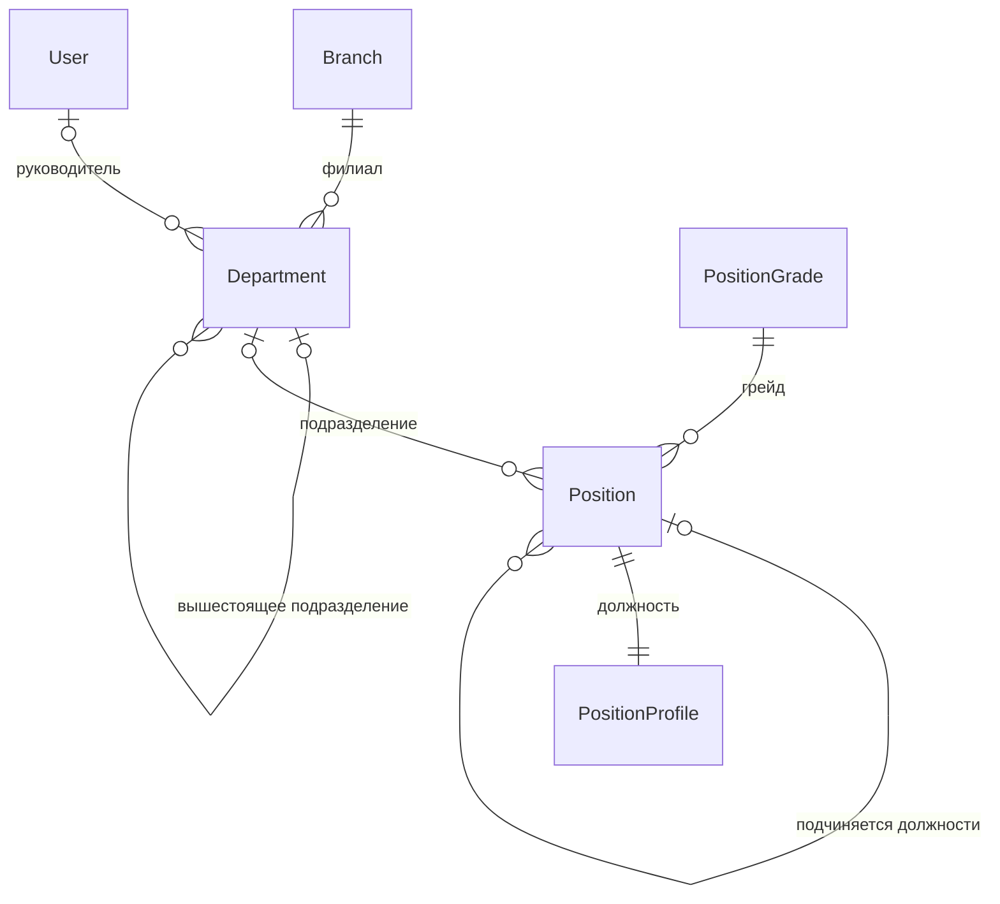
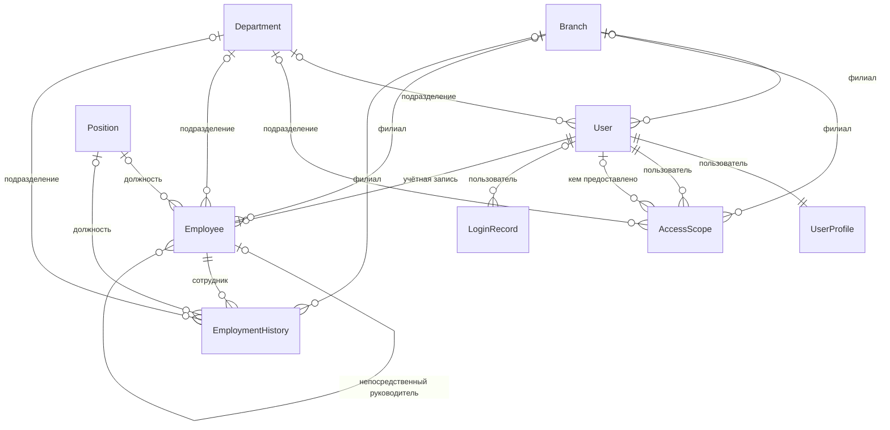
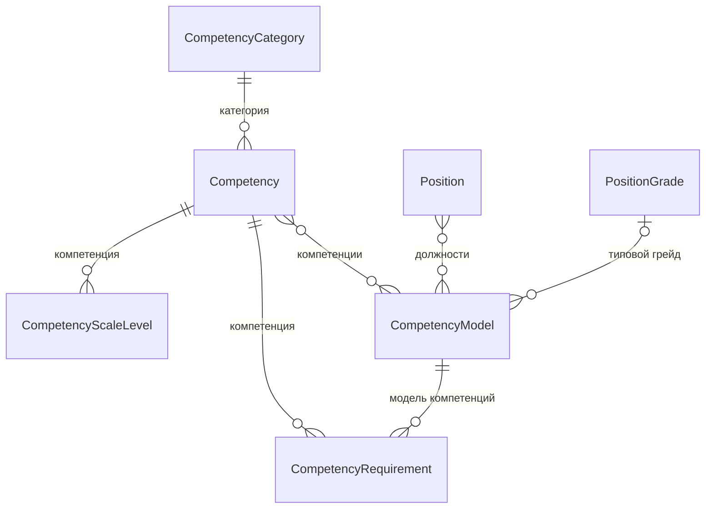
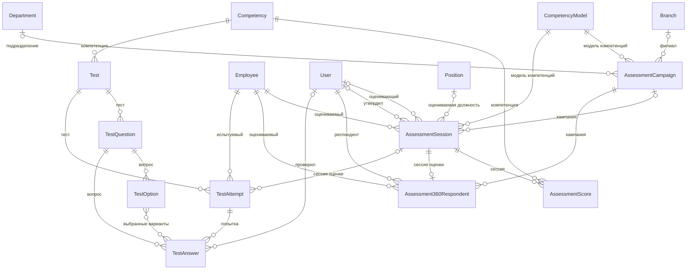
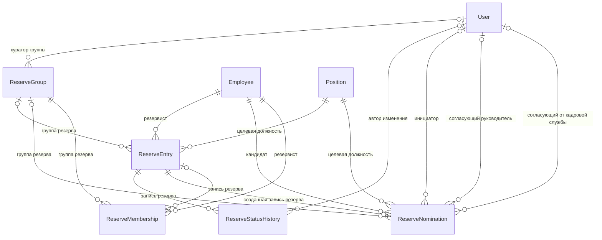
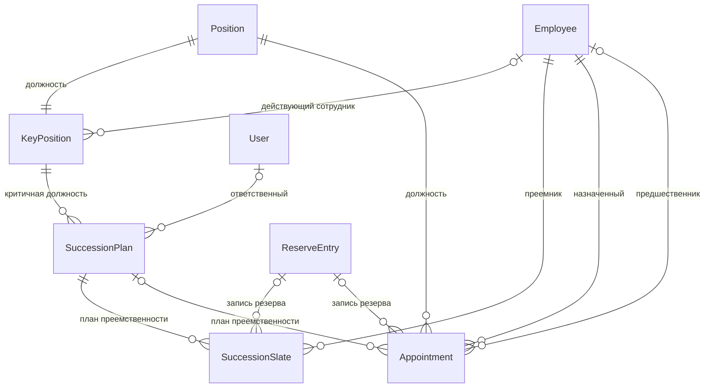
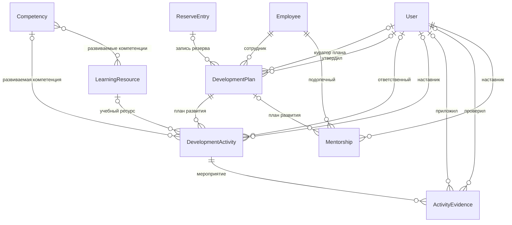
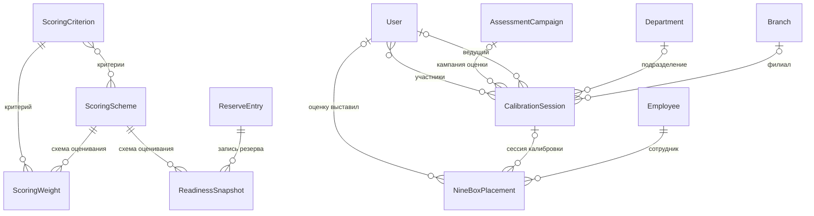
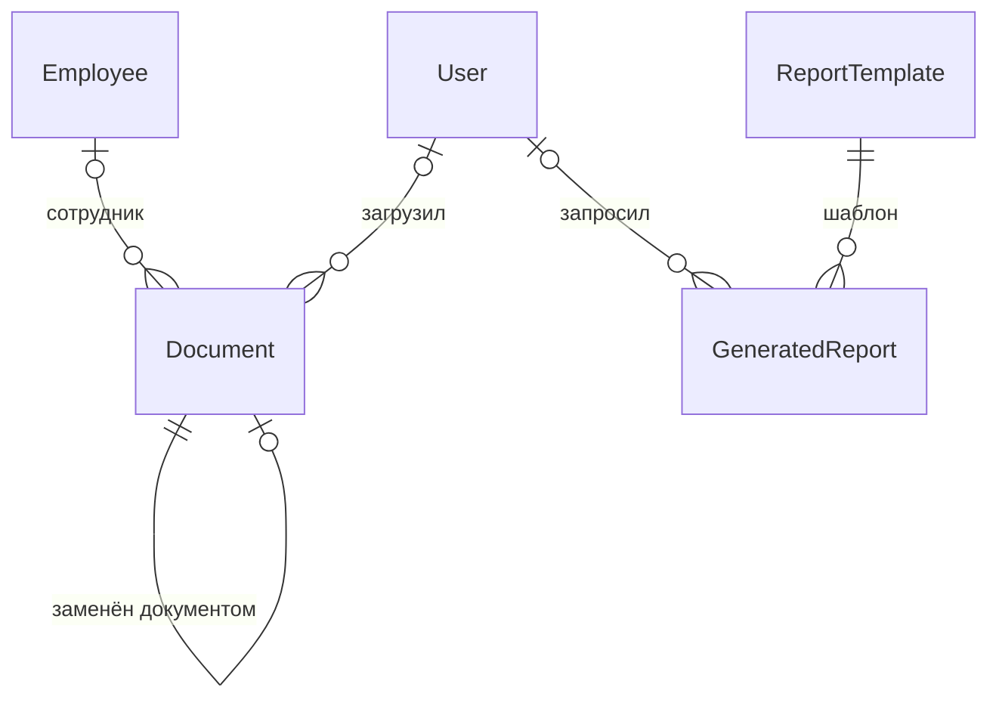
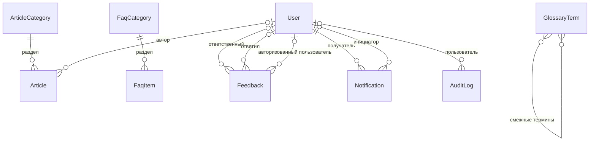

# Модель данных

Схема системы содержит **57 моделей** и 83 таблицы в базе данных. Модель строится вокруг реального кадрового
процесса, а не вокруг экранных форм:

```
профиль должности → модель компетенций → оценка → расчёт готовности →
9-box и калибровка → зачисление в резерв → план развития → назначение
```

Каждая стрелка этой цепочки выражена связью в базе данных. Именно связность
отличает систему от набора справочников: разрыв компетенций вычисляется
сопоставлением оценки с требованием модели, индекс готовности — свёрткой
частных критериев, а доля назначений из резерва — соотношением записей
назначений и записей резерва. Ни одна из этих величин не хранится как
введённое человеком число.

## Отличия от исходной схемы

Исходная схема состояла из девяти таблиц. Четыре решения изменили её
существенно, и каждое вызвано конкретной невозможностью.

**Учётная запись отделена от карточки сотрудника.** В таблицах `User` и
`candidate` персональные данные дублировались: сотрудник, бывший одновременно
пользователем и кандидатом, существовал в базе дважды. Теперь `User` отвечает
за вход и права, `Employee` — за кадровые сведения, связь между ними — «один к
одному» и необязательная. Это позволяет вести сотрудников без доступа в
систему и внешних кандидатов без учётной записи.

**Свободный текст заменён ссылками на справочники.** Поля `target_position`,
`current_position` и `competency_name` были строками, из-за чего «Team Lead» и
«Тимлид» считались разными должностями, а сопоставление кандидата с
требованиями было невыполнимо. Теперь это ссылки на `Position` и `Competency`.

**Снято ограничение `UNIQUE` на кандидата в резерве.** Резервист может идти на
несколько целевых должностей — именно конкуренция кандидатов за должность даёт
материал для ранжирования.

**Добавлены сущности процесса, которых не было вовсе:** профиль должности,
модель компетенций с целевыми уровнями и весами, заявка на выдвижение с
маршрутом согласования, критичная должность, план преемственности, назначение,
схема оценивания, снимок индекса готовности, размещение в матрице 9-box,
сессия калибровки, наставничество, журнал аудита.

## Диаграммы по блокам

Диаграммы разделены по блокам предметной области. Единая схема из 57 сущностей
нечитаема: связи пересекаются, и найти на ней нужную цепочку сложнее, чем в
исходном коде моделей. Служебные связи — права Django, обобщённые ссылки на
объекты и отметки авторства — на диаграммах не показаны: они присутствуют почти
в каждой сущности и не добавляют сведений о предметной области.

### Организационная структура (5)



### Люди и доступ (6)



### Компетентностная модель (5)



### Оценка (9)



### Кадровый резерв (5)



### Преемственность (4)



### Развитие (5)



### Аналитика (6)



### Документы и отчёты (3)



### Публичная часть и сервис (9)



## Ключевые решения о хранении

**Иерархия подразделений — материализованный путь.** Строка вида
`0001.0003.0012` задаёт положение узла в дереве. Подход выбран вместо
рекурсивных запросов потому, что структура организации меняется редко, а
читается постоянно: в каждом списке сотрудников и в каждой проверке прав
руководителя. Стоимость перестроения путей при переносе подразделения
окупается отсутствием рекурсии в горячем пути.

**Индекс готовности хранится, а не вычисляется при чтении.** Расчёт требует
агрегации оценок, кадровых данных и результатов развития по шести критериям.
Выполнять его при отрисовке списка из двухсот записей недопустимо, поэтому
значение хранится в `ReserveEntry`, обновляется фоновой задачей, а история
значений накапливается в `ReadinessSnapshot`.

**Мягкое удаление применяется избирательно.** Оно включено там, где на запись
ссылается история и отчётность: карточка сотрудника, документ. Справочники
используют признак активности — неактивный элемент остаётся видимым в
администрировании, но не предлагается при заполнении форм. Записи журнала
аудита и истории статусов не удаляются вовсе.

**Публичный идентификатор отделён от первичного ключа.** Первичный ключ
остаётся целочисленным ради компактности индексов, а во внешних ссылках —
адресах страниц, программном интерфейсе, ссылках в письмах — используется
`UUID`: он не позволяет перебором узнать численность организации.

**Проверки предметной области закреплены ограничениями базы.** Дата увольнения
обязательна для уволенного и недопустима для работающего; целевой уровень
компетенции не ниже минимально допустимого; выполненное мероприятие имеет дату
выполнения; действующий план преемственности по должности только один. Такие
правила нельзя обойти ни через форму, ни через программный интерфейс, ни
командой сопровождения.

## Соответствие исходным таблицам

| Исходная таблица | Модель системы | Что изменилось |
|---|---|---|
| `branch` | `Branch` | Добавлены код и часовой пояс |
| `department` | `Department` | Добавлена иерархия и руководитель |
| `User` | `User` + `UserProfile` + `AccessScope` | Добавлены область видимости, настройки, история входов |
| `candidate` | `Employee` + `EmploymentHistory` | Отделена от учётной записи, добавлены карьерная история и мобильность |
| `reserve` | `ReserveEntry` + `ReserveNomination` | Снят `UNIQUE`, должность стала ссылкой, добавлено выдвижение |
| `reservestatushistory` | `ReserveStatusHistory` | Добавлен индекс готовности на момент перехода |
| `assessment` | `AssessmentCampaign` + `AssessmentSession` + `AssessmentScore` | Оценка получила процедуру, компетенция — справочник |
| `developmentplan` | `DevelopmentPlan` | Добавлены утверждение и расчёт выполнения |
| `developmentactivity` | `DevelopmentActivity` + `ActivityEvidence` | Добавлены компетенция, вес и подтверждение результата |

## Файлы

* `db/schema.sql` — действующая схема, выгруженная из PostgreSQL 18;
* `db/cadr_reserve.sql` — исходная база данных;
* `db/demo_data.sql` — демонстрационные данные;
* `db/README.md` — описание содержимого каталога.
